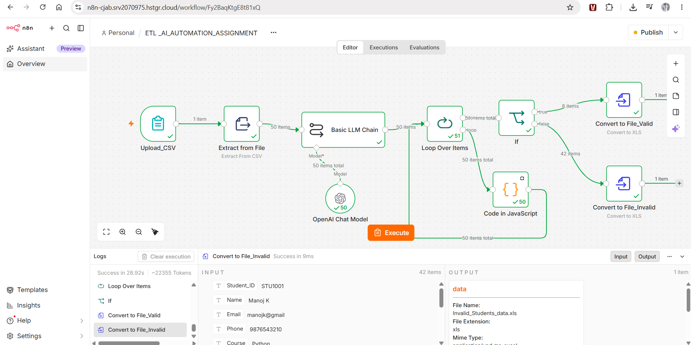
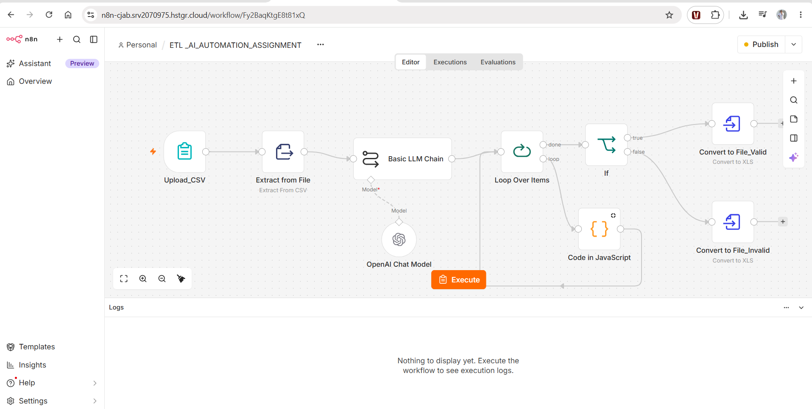

# n8n Student Data ETL Automation

An ETL automation in n8n that takes a raw student enrollment CSV and splits it into valid Chennai student records and invalid records.

> Part of my Gen AI course practice work (Week 3, Day 3).

## Tech stack

- n8n
- CSV / Excel

## Features

- Raw input with messy names, emails, phones and cities
- Output files for valid and invalid records
- Before-run and after-run screenshots

## Getting started

1. Clone the repository:
   ```bash
   git clone https://github.com/Prembazskar/n8n-student-data-etl-automation.git
   cd n8n-student-data-etl-automation
   ```
2. Run n8n (see the self-hosting repo) and build the workflow against `data/student_enrollment_raw.csv`.

## Screenshots





## License

MIT, see [LICENSE](LICENSE).
